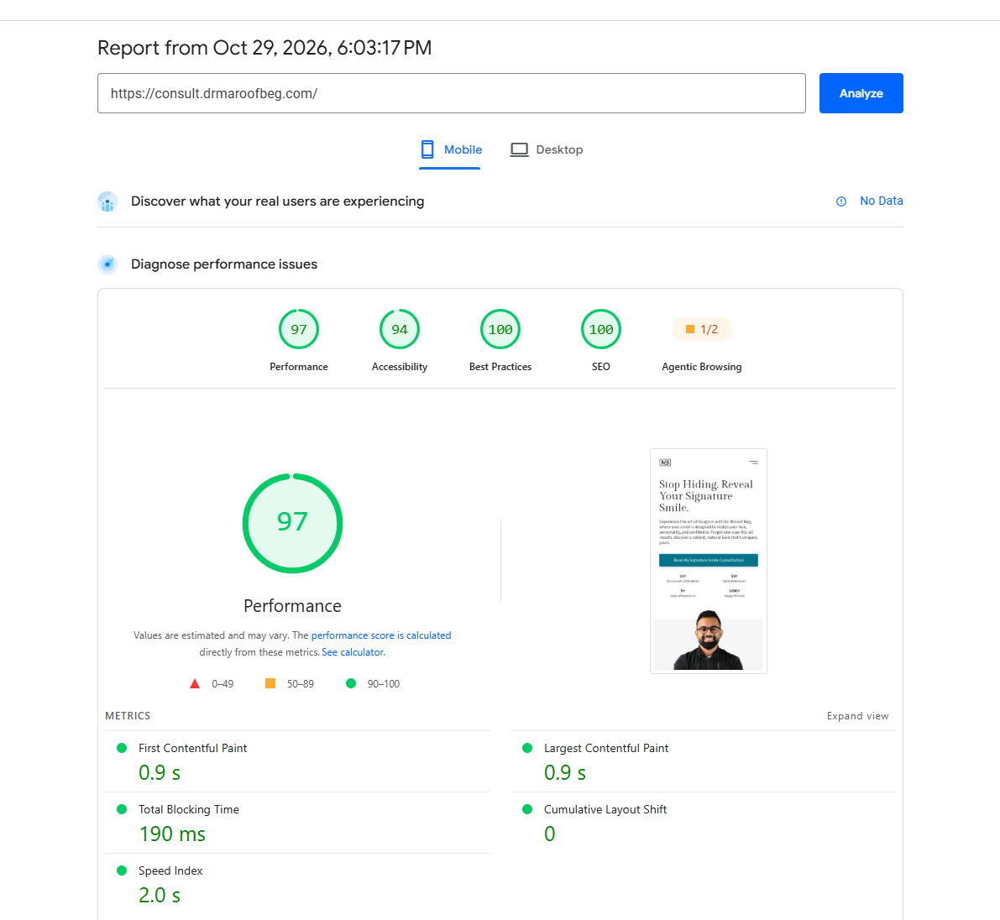

# Signature Smile Consultation: Landing Page for a Dubai Cosmetic Dentist

A single-goal, mobile-first landing page built to turn paid-ad and search visitors into **WhatsApp consultation requests** for a Dubai cosmetic dentist who practises _Visagism_, the approach of designing a smile to match a person's face, personality, and expression.

**Live:** https://consult.drmaroofbeg.com
**Stack:** Next.js 16 · React 19 · TypeScript · Tailwind CSS 4 · Google Tag Manager (GA4)
**Status:** Live, pro bono project. No paid campaign has run yet, so there is **no conversion data**. The measurement setup is in place, and the performance numbers below are lab data.

## Results at a glance

Mobile PageSpeed Insights

| Performance | Accessibility | Best Practices | SEO |
| :---------: | :-----------: | :------------: | :-: |
|     97      |      94       |      100       | 100 |

|  FCP  |  LCP  |  TBT   | CLS | Speed Index |
| :---: | :---: | :----: | :-: | :---------: |
| 0.9 s | 0.9 s | 190 ms |  0  |    2.0 s    |



These are lab results, not field data. They show the page loads quickly on a phone, which matters because ad traffic in the UAE is mostly mobile.

## The conversion goal

One page, one action: **book a free consultation**. Cosmetic dentistry is a considered, emotional, and expensive purchase, and the visitor's biggest fear is getting a generic result. The page therefore sells the _difference_ (a smile designed for your face) before it asks for the booking.

**Primary conversion:** a click on the WhatsApp booking button.
**Secondary signals:** scroll depth and page views.

## Key design decisions (and why)

| Decision                                 | Reasoning                                                                                                                                                                                                    |
| ---------------------------------------- | ------------------------------------------------------------------------------------------------------------------------------------------------------------------------------------------------------------ |
| **Differentiated positioning in the H1** | "Stop Hiding. Reveal Your Signature Smile." plus the Visagism explanation sets the practice apart from "generic smile makeover" competitors, who all promise the same result.                                |
| **Problem → transformation narrative**   | The page opens with the visitor's pain ("Tired of a Smile That Doesn't Feel Like You?"), then presents the solution ("Where Art Meets Science"). Visitors recognise themselves before they are asked to act. |
| **WhatsApp instead of a form**           | Messaging is the default way to contact a clinic in the UAE. One tap opens a pre-filled message, with no form, no typing, and no waiting for a callback.                                                     |
| **Credibility next to the CTA**          | Four credibility stats (certifications, smile makeovers, years of experience, happy patients) sit directly under the hero button, so proof is visible at the moment of decision.                             |
| **Mobile sticky CTA**                    | Appears after the visitor scrolls past half of the first screen, so it does not compete with the hero button. Mobile only, with safe-area padding for notched phones.                                        |
| **Proof sequence**                       | Testimonials ("Real Patients. Real Transformations.") are followed by before-and-after images, which suit a visual treatment and give skeptics evidence.                                                     |
| **FAQ as objection handling**            | Six questions answer the main fears: what Visagism is, how long results last, whether I am a good candidate, pain and recovery, whether it will look natural or "too perfect", and how many visits it takes. |
| **Authority signal**                     | The About section states the dentist's regulator licence, which matters in a healthcare decision.                                                                                                            |

## Measurement

Google Tag Manager is installed site-wide (loaded after interactive, with a no-script fallback). The container contains:

| Tag                                  | Trigger                                         | Purpose                                                                |
| ------------------------------------ | ----------------------------------------------- | ---------------------------------------------------------------------- |
| GA4 Config (Google tag)              | Initialization, all pages                       | Page views and GA4 configuration                                       |
| `CTA click` (GA4 event)              | Link click where the Click URL contains `wa.me` | Counts every WhatsApp booking click with one rule                      |
| `Scroll Depth Threshold` (GA4 event) | Scroll depth trigger                            | Event named `scroll_{{threshold}}` with a `percent_scrolled` parameter |

**Metrics to watch once ads run:** WhatsApp click-through rate (`CTA click` ÷ sessions), cost per WhatsApp click, and scroll-depth drop-off by section.

## CRO hypotheses and testing plan

The design treats conversion decisions as hypotheses to investigate, not as proven results. **No conversion uplift or real-user behavior is claimed.**

**Defining the conversion.** A WhatsApp click is a _proxy_, not a booked consultation. The full funnel is: page view → WhatsApp click → conversation started → consultation booked → consultation attended. The page can only measure the first two steps, so I would agree with the clinic on tracking the later steps (for example, a simple weekly count of bookings that came from the page) before judging any change.

|  #  | Observation                                                                                                           | Hypothesis                                                                                                  | Test                                 | Primary metric                                            |
| :-: | --------------------------------------------------------------------------------------------------------------------- | ----------------------------------------------------------------------------------------------------------- | ------------------------------------ | --------------------------------------------------------- |
|  1  | Visitors fear a "one-size-fits-all" result.                                                                           | A headline built on personalised design (Visagism) outperforms a generic "smile makeover" headline.         | Two H1 variants.                     | WhatsApp click-through rate                               |
|  2  | The button says "Book My Signature Smile Consultation", but the pre-filled WhatsApp message says "Free Consultation". | Saying "free" in the button label lowers perceived risk and raises click-through.                           | Two CTA label variants.              | WhatsApp click-through rate                               |
|  3  | On mobile, the hero CTA scrolls out of view.                                                                          | A sticky CTA that appears after half a screen of scrolling raises click-through without hurting engagement. | Sticky CTA on vs. off.               | Click-through rate, scroll depth                          |
|  4  | The page opens with three emotional pain points before any offer.                                                     | Emotional problem framing increases engagement, but heavy wording could put some visitors off.              | Shorter vs. current problem section. | Scroll depth past the problem section, click-through rate |
|  5  | Many visitors will not scroll far.                                                                                    | Moving testimonials closer to the hero raises click-through from low-scroll visitors.                       | Reorder sections.                    | Click-through rate for visitors who stop above the fold   |

**Realistic testing approach.** A single clinic page may not get enough traffic for a statistically sound A/B test. Until traffic grows, the plan is to establish a baseline first, change one thing at a time, compare before and after over equal periods, and read scroll-depth data alongside clicks to see where visitors drop off.

**Privacy.** Dental enquiries can involve sensitive personal information, so analytics events should record interactions only and never names, phone numbers, or health details.

## Performance and accessibility techniques

- **LCP image:** the hero image uses `priority` and `fetchPriority="high"` with explicit dimensions and a tuned `sizes` attribute, which keeps LCP at 0.9 s.
- **Fonts:** `next/font` (Gilda Display and Source Sans 3) with `display: swap`, preloading, and metric-adjusted fallback fonts to limit layout shift.
- **Images:** `next/image` with AVIF and WebP output, tuned device sizes, a one-year cache TTL, and assets stored as WebP.
- **Lazy-loaded sections:** everything below the fold loads through `next/dynamic` with skeleton placeholders, which keeps the initial bundle and main thread light.
- **CSS and bundle:** `inlineCss` enabled, and `optimizePackageImports` for the icon library.
- **Scroll animations:** a small IntersectionObserver hook (`useOnScreen`) triggers section animations as they enter the viewport.
- **Sticky CTA:** passive scroll listener and `env(safe-area-inset-bottom)` padding.
- **FAQ accordion:** native buttons with `aria-expanded`.

## Trade-offs and next steps

- **TBT is 190 ms**, the highest metric on the report and still in the green. The Tag Manager script and the client-only sections are the first things to investigate, for example by measuring with and without GTM.
- The below-the-fold sections load client-side only (`ssr: false`), which helped performance but means their content is not in the initial HTML. Server-rendering the FAQ and testimonials is worth testing for search visibility.
- The FAQ items share one `aria-controls` id, and the hero image alt text is generic. Fixing both should lift the accessibility score above 94.
- The CTA button wraps a link in a `<button>`. A single styled `<a>` would make the full button area tappable and the markup valid.
- The sticky CTA opens WhatsApp in the same tab, while the hero CTA opens a new tab. Aligning them, or enabling "Wait for Tags" on the click trigger, protects the click event from being lost during navigation.
- The WhatsApp link is repeated in three components. Moving it into one constant removes the risk of mismatched numbers.
- The hero image's blur placeholder needs a real `blurDataURL` value, or the placeholder should be removed.
- Once traffic exists: validate the GTM events in GA4, register `percent_scrolled` as a custom dimension, and run the first test.

## Project structure

```
app/
  layout.tsx            Metadata, fonts, GTM
  page.tsx              Header, hero, lazy sections, sticky CTA
  ClientSections.tsx    next/dynamic loading with skeletons
components/
  Header/               Desktop and mobile navigation
  sections/             Hero, Problem, Transformation, Testimonials,
                        BeforeAfters, Benefits, About, FAQs, CTA, Footer
  UI/                   CTABtn, StickyCTA, FAQItem, cards, Section
constants/index.tsx     Page copy and content data
hooks/useOnScreen.ts    Visibility hook
```

## Run locally

```bash
npm install
npm run dev
```

Open http://localhost:3000. The GTM container ID is set in `app/layout.tsx`.

## About this project

Built end to end (layout, conversion structure, development, deployment, and analytics setup) as a pro bono project to practise conversion-focused landing page work on a real business. The clinic has not yet run paid campaigns, so I do not claim any uplift. What I can show is a fast, accessible page, a deliberate conversion path built around a clear differentiator, and tracking that is ready to prove or disprove the hypotheses above.
